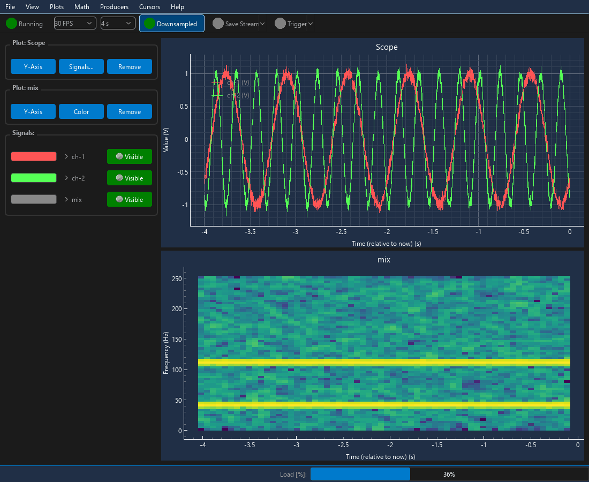

# Oscilab

[](https://github.com/hirschlersim/Oscilab/actions/workflows/ci.yml)
[](https://github.com/hirschlersim/Oscilab/actions/workflows/ci.yml)
[](https://www.python.org/)
[](LICENSE)
[](https://hirschlersim.github.io/Oscilab/)

A real-time oscilloscope and data-acquisition app in Python and Qt: stream
any source (a serial port, UDP packets, your phone's sensors, a game
controller) into live plots, with a scope's trigger, spectrograms and
recording to HDF5.



Built with PyQt6 and pyqtgraph. It started as a way to explore real-time
DSP visualization and signal-chain architecture in Python.

## Quick start

Requires Python 3.12+ and [uv](https://docs.astral.sh/uv/). Developed and
tested on Windows, where CI runs too. The Xbox producer needs Windows; the
rest is plain PyQt6 and should run on Linux and macOS, but that's untested.

```bash
git clone https://github.com/hirschlersim/Oscilab
cd Oscilab
uv sync
uv run oscilab-demo
```

Every showcase and benchmark is a command of its own; `--help` lists a
command's options:

| Command | What it does |
| --- | --- |
| `uv run oscilab [session.json]` | An empty window — or a saved session |
| `uv run oscilab-demo` | Synthetic signals: plots, a spectrogram, math, toolbar controls |
| `uv run oscilab-xbox` | An Xbox controller's sticks, triggers and buttons ([guide](docs/guide.md#an-xbox-controller)) |
| `uv run oscilab-sensor-logger` | Your phone's sensors, from the Sensor Logger app ([guide](docs/guide.md#your-phones-sensors-sensor-logger)) |
| `uv run oscilab-udp --demo` | Samples over UDP, sending itself some ([guide](docs/guide.md#samples-over-udp)) |
| `uv run oscilab-bench` | Where Oscilab keeps up: a figure of channels x sample rate |

## Features

- **Trigger** — as on an NI digitizer: edge, hysteresis, window or
  immediate; DC/AC coupling, holdoff, delay; a timebase and reference
  position; Run / Single / Stop / Force, Auto or Normal, and Autoset. The
  time plots hold the record around each trigger, the level a line to drag.
- **Time-series plots** — multi-signal, auto-scrolling, with global or
  "relative to now" time modes, peak-preserving downsampling for large
  buffers, manual or auto Y-ranging, and classic two-cursor (ΔT, 1/ΔT,
  per-signal value) measurement.
- **Live spectrograms** — STFT view per signal, computed incrementally
  (only new samples are transformed each tick, not the whole rolling
  buffer — see [How it works](docs/how-it-works.md#4-the-spectrogram-computes-only-whats-new)).
- **Logic lanes** — on/off signals (buttons, digital lines) in a lane each,
  like a logic analyzer, on the same time axis as the other plots.
- **XY plots** — one signal against another: a joystick's path, Lissajous
  figures, I-V curves; the signals may run at different rates.
- **Histograms** — a signal's value distribution, with its mean and
  standard deviation: noise, clipping, quantization steps.
- **Per-signal controls** — visibility, IIR filtering, offset/gain
  scaling, curve color, unit, and live Min/Mean/Max/Peak-to-Peak/RMS
  metrics. Rows start collapsed; click a signal's name for its details.
- **Signal units** — V, A, °C, ... per signal, shown in legends, on Y axes,
  in metrics and cursor readouts; math signals derive theirs (V × A → V·A).
- **Signal math** — derive a new signal as `A op B` (`+ - * /`) from two
  existing signals.
- **Build the layout in the app** — add any kind of plot from the Plots
  menu; each plot's panel picks the signals it shows or removes it.
  Producers are attached in code, and started, stopped or removed from the
  Producers menu.
- **Pluggable data producers** — background `QThread`-based producers
  with a synchronous or `asyncio` base class, multi-channel; the Producers
  menu starts, stops and removes them and runs their own functions (which
  can go in the toolbar too). An error stops only the producer that hit it.
  Ships with a synthetic signal generator, a CSV file-replay producer, an
  Xbox controller producer (Bluetooth or USB, on Windows), a phone's
  sensors via the Sensor Logger app, samples over UDP (an ESP32 on Wi-Fi,
  a simulation, any program), and templates for serial and `asyncio`
  sources.
- **A ring buffer per signal** — a thread-safe, pre-allocated numpy
  circular buffer, read as one array every refresh.
- **Save Stream** — record every sample of every signal to HDF5 files
  while it's on, not just what's still in the buffers; a new file at a
  size you choose. **Replay Recording** plays them back — a file or a
  whole folder, looped if you like.
- **Light/dark theming**, tooltips throughout, and export to
  PNG/SVG/PDF/CSV/MAT/HDF5.

## From your own code

[`demo.py`](src/oscilab/demo.py) is a good starting point for the public
API:

```python
from oscilab import AsyncSyntheticProducer, Oscilab, SyntheticProducer

scope = Oscilab()

# Each producer registers its own signals, one per channel, at its own fs
scope.attach_producer(SyntheticProducer(fs=100, freq=5.0), "channel-1", units="V")
scope.attach_producer(SyntheticProducer(fs=1_000, freq=(1.0, 10.0)), ["channel-2", "channel-3"])
scope.attach_producer(AsyncSyntheticProducer(fs=200, freq=2.0), "async")  # "Reset Phase" in the toolbar

scope.add_timeseries_plot("Sensors")
scope.link(plot="Sensors", label="channel-1")
scope.link(plot="Sensors", label="channel-2")
scope.link(plot="Sensors", label="async")

scope.add_spectrogram_plot(label="channel-3")

scope.run()  # shows the window; blocks until it's closed
```

Your own data source (a sensor, an instrument, a file, another program) is
a producer, in about ten lines: see [Writing a producer](docs/writing-a-producer.md).

### In your own project

Oscilab isn't on PyPI. Fork it, or add it to your project straight from
GitHub, or as a git submodule to change it in place:

```bash
uv add git+https://github.com/hirschlersim/Oscilab   # pip install git+https://... works too

git submodule add https://github.com/hirschlersim/Oscilab oscilab   # or this,
uv add --editable ./oscilab                                          # its changes live
```

## Documentation

- **[User guide](docs/guide.md)**: the showcases (an Xbox controller, your
  phone's sensors, UDP), your own toolbar controls, the trigger, Save
  Stream and replay, units, sessions, logging.
- **[Writing a producer](docs/writing-a-producer.md)**: your own sensor or
  instrument, live.
- **[How it works](docs/how-it-works.md)**: the design, why it's built that
  way, and where things are in the code.
- **[API reference](https://hirschlersim.github.io/Oscilab/)**: every
  public class and function, from the docstrings.

## Development

```bash
uv run pytest
uv run coverage run -m pytest && uv run coverage report   # ...and what they leave out
uv run ruff check && uv run ruff format                   # config in ruff.toml
uv run mypy                                               # config in pyproject.toml
uv run --group docs scripts/docs.py                       # the API reference, live at localhost:8080
```

The code is fully type-annotated; mypy checks it strictly, and checks the
tests' use of it. Tests run headless (Qt's offscreen platform), so they work
without a display. CI runs them on every push and pull request, with ruff
and mypy; it fails below 90 % coverage, opens a window from the built
wheel, as a fork or a `git+https://` install gets it, and publishes the API
reference.

They cover the ring buffer, signal model (filter/scaling/resize), math
signals and units, every plot type, the spectrogram's incremental STFT
cache, the producer base classes (threads, errors, actions, multi-channel
data, keeping up with real time), the bundled producers against stand-ins
(a fake serial port and XInput, HTTP pushes and UDP packets over
localhost), the trigger (detection, acquisition, its panel), the cursor
readout, the menus, toolbar and dialogs, Save Stream and replay, sessions
and the window's state, logging, workspace rules, the File-menu exports,
what keeps drawing fast, and every command.

## How this was built

Oscilab was built with an AI coding assistant, Claude (Anthropic); the
commits it worked on say so, with a `Co-Authored-By: Claude` line.

- **Me**: the software design, and the direction the project developed
  in; reviewing the code, with a final proofread of what went in; testing
  it, and the final validation on real hardware.
- **Claude**: writing the code, to that design.

## License

MIT — see [LICENSE](LICENSE).
