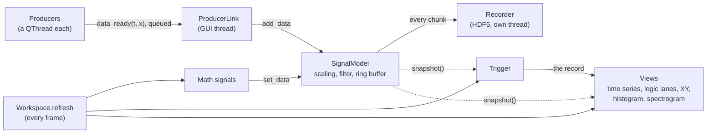

# How Oscilab works

A sample's way from a sensor to the screen, and the design decisions along
it. The code has the details; these notes say why it's built the way it
is.



## 1. Producers hand their data over through queued Qt signals

Every data source (a serial port, a UDP socket, a game controller, a
phone) is a producer running on a `QThread` of its own, so a blocking read
never holds up the window. A producer doesn't touch the signals' buffers:
it emits `data_ready(t, x)`, one chunk of samples at a time. That
connection crosses threads, so Qt queues it, and the chunk is stored on the
GUI thread, between two frames: samples never arrive in the middle of a
redraw.

The receiving end is a small `QObject`, `_ProducerLink`, a child of the
producer, rather than a plain Python callback. When a producer is removed,
the link is deleted with it and Qt drops the deliveries still queued for
it. With plain callbacks, deliveries queued before a window closed were
once run after its producers had been garbage-collected: a hard crash.

An exception in a producer stops only that producer: it's reported on its
signals' rows, with a Restart button, and everything else carries on.
Producers that make their samples themselves (synthetic signals, a file
played back) emit whatever is due by the wall clock, not a fixed chunk per
`sleep()`: on Windows a sleep comes round to the next 15.6 ms clock tick,
and a fixed chunk would fall further and further behind real time.

## 2. A ring buffer per signal

Each signal keeps the last few seconds of its times and values in a
`RingBuffer`: a numpy array allocated once, used in a circle. Adding
samples writes into it, overwriting the oldest once it's full; nothing is
allocated per sample. Reading it is one array copy, or two slices joined
where it wraps. There used to be a `deque` option too: reading one means
turning thousands of Python floats into an array, every frame, for every
signal. Benchmarked against each other, the ring buffer was faster in
every case, so the deque went.

Several things read a signal each frame (its curve, its metrics, a math
signal, a spectrogram), so `SignalModel.snapshot()` makes that array once
per frame and they all share it.

The buffer still has a lock, though producers deliver on the GUI thread: a
signal can also be fed by hand, from any thread, and adding samples is
several steps that a reader mustn't see half done.

## 3. The trigger: interpolated crossings, and holdoff

The trigger works like a digitizer's (NI-SCOPE's terms) and is pure
Python and numpy, without Qt, so it's tested on its own. Each frame,
`TriggerDetector` gets the source's new samples and looks for the trigger
condition between each pair of them.

A crossing almost never falls on a sample, so its time is interpolated
between the two samples around it:
`t = t0 + (level - y0) / (y1 - y0) * (t1 - t0)`. Records then line up to
better than a sample; taking the sample itself, a waveform would jitter by
up to one sample period from record to record.

**Holdoff** ignores triggers for a while after one, so a burst triggers
once, not on every edge in it. **Hysteresis** only counts an edge once the
signal has been a set distance on the other side of the level first, so
noise on a slow edge can't set it off again and again. `Acquisition` runs
the cycle: armed, triggered, the record complete, then armed again (Run)
or stopped (Single). With Auto, a record is taken anyway when no trigger
comes, so the display never freezes. Every time plot shows the same record
around the trigger, as a scope's channels do.

## 4. The spectrogram computes only what's new

A spectrogram is a short-time Fourier transform (STFT) of the signal's
buffer. Recomputing it over the whole buffer every frame would mostly
redo the same columns: at 30 frames a second, only a few new samples have
arrived since the last one. So `SpectrogramPlot` keeps the columns it has
computed, each with its time, and transforms only the new samples, plus
enough of the old ones for the windows to overlap. Columns that have
scrolled out of the buffer are dropped.

Two details make this match a full recompute. Each piece transformed
starts a whole number of hops before the last cached column, so its
columns land on the same time grid as the cached ones, even after the
buffer has wrapped. And `scipy.signal.stft` pads both ends of whatever
it's given, which makes the last few columns of each piece wrong, so those
are never cached: they're shown from a preview recomputed every frame,
until enough samples have come after them to compute them for good.

## 5. The domain layer, apart from the window

`Workspace` owns everything that isn't window chrome: the signals, math
signals, plots and producers, the wiring between them, and the refresh.
It has no main window, so most of the logic is tested without one.
Creating and removing plots (`Plotting`) and applying the trigger
(`Triggering`) are classes of their own beside it.

Every plot type implements one interface, `View`. The workspace drives
them all through it: refresh, theme, time mode, Reset View, the Y-Axis
button, image export. A new plot type gets all of that by implementing it,
without changes to the workspace.

The main window, `Oscilab`, is the public API scripts use, and puts the
parts together. Each feature's menus, toolbar entries and panels are a
small module in `ui/`, so a new feature doesn't grow one big window class.

## 6. Drawing fast enough

A benchmark (`oscilab-bench`) measures where Oscilab keeps up at 30 frames
a second, over channels and sample rates. At first one channel at 100 Hz
took 47 ms a frame. The benchmark showed the causes, and fixing them
brought it to 12 ms:

- Qt draws translucent lines about 25 times slower than solid ones, and
  pyqtgraph draws the grid translucent, over the data: 25 ms a frame, per
  plot. The grid is now drawn in solid colors that look the same, behind
  the data.
- Every frame was painted twice, as the plots fitted their axes during the
  paint. They're fitted right after the refresh now.
- Curves are 1 pixel wide, which Qt draws the fast way, and downsampled to
  two min-max pairs per pixel column.
- The refresh timer is a precise one: the coarse one came round to
  Windows' 15.6 ms clock ticks, 21 frames a second for 30.

## Where things are in the code

```
producers.py          Background QThread data sources (Sync/Async base classes)
toolbar.py             ├─ @button / @toggle: their functions in the menus and toolbar
xbox.py                ├─ an Xbox controller, through XInput
sensor_logger.py       ├─ a phone's sensors, from the Sensor Logger app
udp.py                 └─ samples over UDP
    │
signal_model.py       Rolling buffer, filtering, scaling, metrics per signal
ring_buffer.py         ├─ the thread-safe numpy circular buffer it keeps them in
math_signal.py         └─ derived signal (A op B)
    │
view.py               The interface every plot type implements
grid.py                ├─ the base of the plots with a grid: one paint a frame
timeseries_plot.py     ├─ scrolling time-series plot
logic_plot.py          ├─ logic lanes (a kind of time-series plot)
xy_plot.py             ├─ one signal against another
histogram_plot.py      ├─ a signal's value distribution
spectrogram_plot.py    └─ live STFT spectrogram
trigger.py            Triggering: detection and Run/Single/Stop (no Qt)
trigger_panel.py       └─ its controls, in the sidebar
    │
signal_controller.py  Per-signal sidebar controls (SignalRow / SignalController)
dialogs.py            Modal dialogs: range, filter, scaling, math
    │
workspace.py          Domain layer: owns all registries and wiring
plotting.py            ├─ its plots: creating them, linking signals, removing them
triggering.py          ├─ the trigger applied to its time plots
exporters.py           ├─ PNG/SVG/PDF images, CSV/.mat/.h5 data
recorder.py            ├─ Save Stream: every sample to HDF5, as it arrives
replay.py              └─ ...and playing those recordings back
    │
oscilab.py            QMainWindow: puts the parts together; the API scripts use
ui/                    ├─ each feature's menus, toolbar entries, panels, dialogs:
                       │    file_menu, plots_menu, producers_menu, controls,
                       │    recording (Save Stream, Replay), trigger
session.py             ├─ save/restore a whole setup as JSON
log.py                 └─ logging: console, log file, status bar
    │
demo.py               Example usage / `uv run oscilab-demo` entry point
examples/             The showcases, a command each: xbox, sensor_logger, udp
benchmarks/           How fast it is: refresh (`oscilab-bench`)
__main__.py           `uv run oscilab [session.json]` entry point
```

Roughly bottom-up: data model → producers → plots → per-signal controls →
the `Workspace` layer that wires everything together → the `QMainWindow`
on top, assembled from one small part per feature in `ui/` — so a new
feature's menus and panels go in a module of their own. To add a plot
type (an FFT, say), implement `View` in [view.py](../src/oscilab/view.py) and
add an `add_*` method for it to `Plotting` in
[plotting.py](../src/oscilab/plotting.py), which `Workspace` hands on —
theming, time modes, Reset View, the Y-Axis button and image export then
work for it without further changes.
